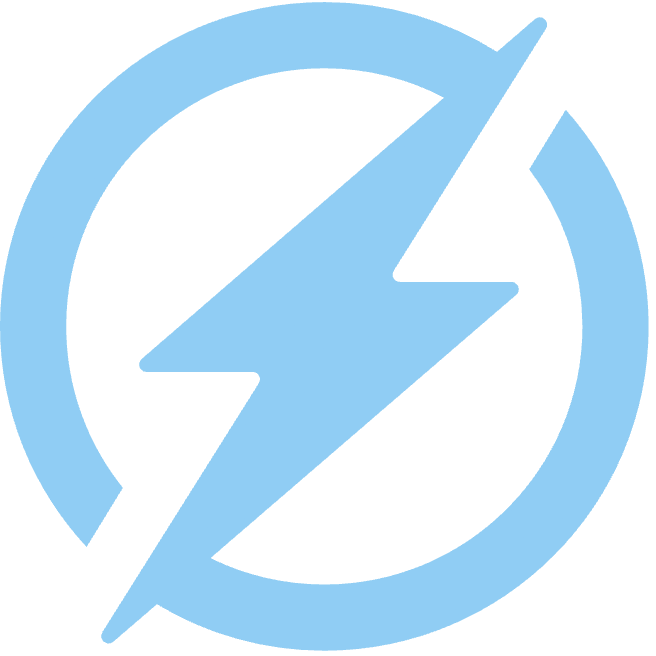
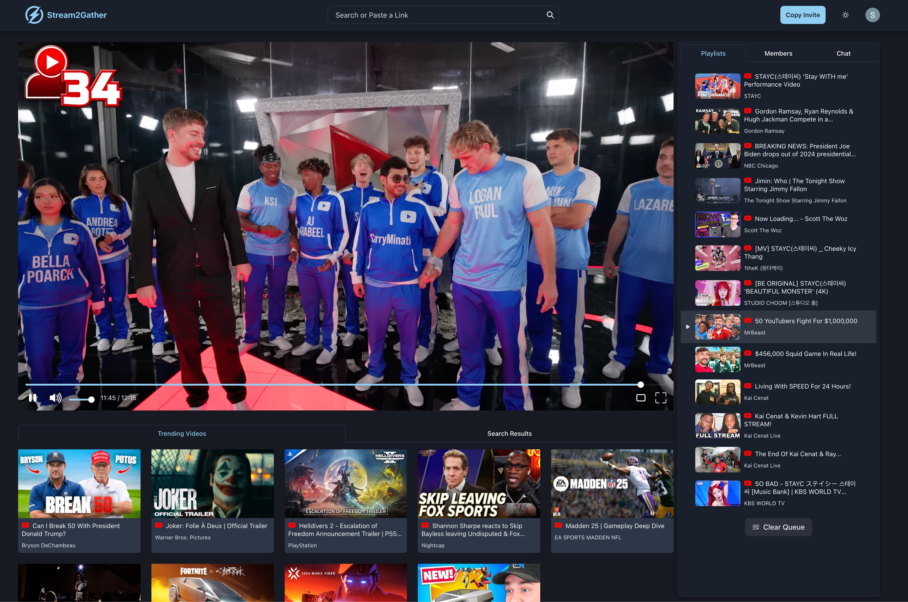
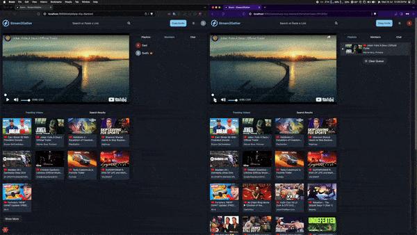
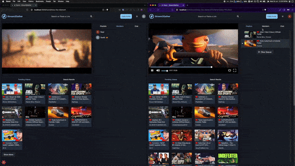

<!-- markdownlint-disable MD033 MD041 -->

<h1 align="center">Stream2Gather</h1>

<b>Stay connected made easier</b>

## Overview

**Stream2Gather** is a watch-together web app. Everyone in a room sees the same YouTube video at the same moment, with a shared queue and live chat. Play, pause and seek reach the whole room over a WebSocket, and each browser keeps itself on the room's timeline. Nobody needs an account to join.

> **Rebuild in progress.** `server/` (Go) and `web/` (Vite, React) replace `backend/` and `frontend/`. See [the plan](docs/rebuild/plan.md) and [the measurements](docs/rebuild/measurements.md).
>
> To run it, add `YOUTUBE_API_KEY` to `server/.env.local`, then run `make up web serve` and open <http://127.0.0.1:18080>. Background jobs need `make temporal` and `make worker`.
>
> `make test` runs the unit tests. `make e2e` runs real browsers against a private server on port 18082; it needs `make up`, Google Chrome and ffmpeg, and builds everything else itself.

## Quick Demo

### Video Controls and Playback

### Live Chat

## Built With

- [Go](https://go.dev/) - The server: HTTP API, WebSocket hub and background jobs
- [Redis](https://redis.io/) - Live room state, presence and pub/sub between servers
- [PostgreSQL](https://www.postgresql.org/) - Rooms, chat history and cached video metadata
- [React](https://react.dev/) with [Vite](https://vite.dev/) - The web client, styled with [Tailwind CSS](https://tailwindcss.com/)
- [Temporal](https://temporal.io/) - Background jobs, kept off the playback path
- [ClickHouse](https://clickhouse.com/) and [Grafana](https://grafana.com/) - Playback telemetry
- [Clerk](https://clerk.com/) - Optional sign-in; guests need no account

## Installation

See the note under [Overview](#overview) to run the rebuild. The [frontend](/frontend/README.md) and [backend](/backend/README.md) folders hold the legacy app, with their own instructions.

## License

This project is licensed under the MIT License - see the [LICENSE](LICENSE)
