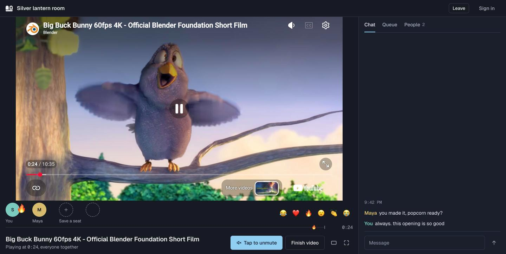
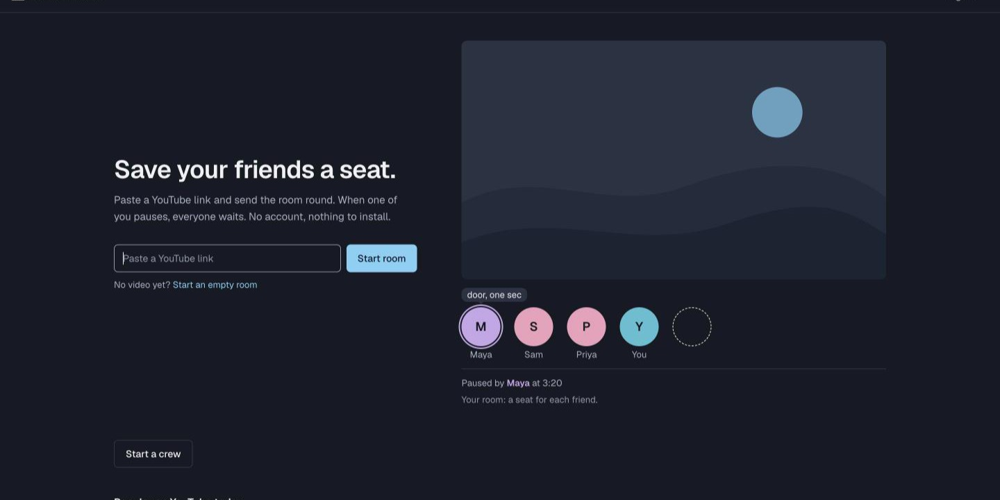
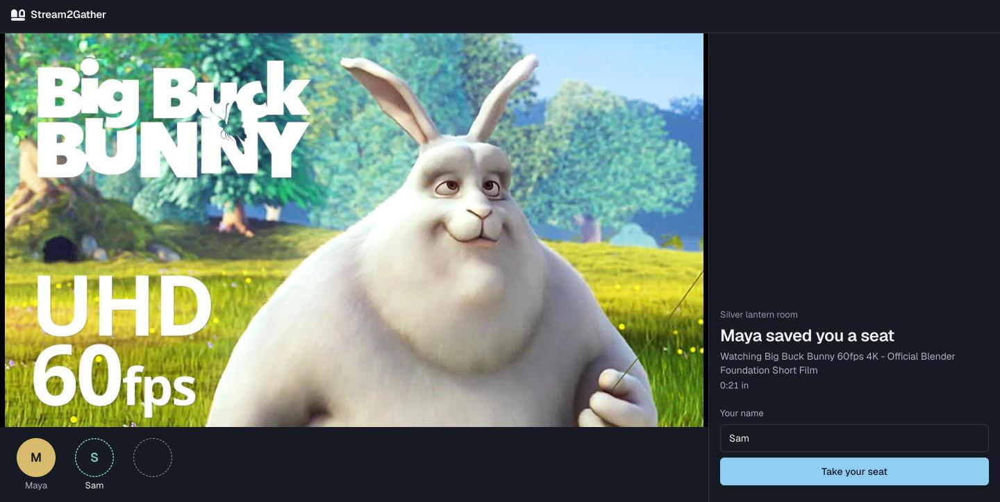

<!-- markdownlint-disable MD033 MD041 -->
<p align="center"></p>

<h1 align="center">Stream2Gather</h1>

<p align="center"><b>Save your friends a seat.</b></p>

<p align="center"></p>

Stream2Gather is a watch-together web app. Paste a YouTube link, send the room to your friends, and everyone sees the same moment. When one of you pauses, everyone waits. Nobody needs an account to join.

## What's in a room

- **Playback in sync:** play, pause and seek reach everyone, and each browser keeps itself on the room's timeline.
- **Seats:** everyone has a place under the video, and reactions appear on their seat.
- **Shared queue:** search YouTube or paste a link, then reorder what's next together.
- **Live chat:** it stays beside the video, and in fullscreen too.
- **Voice:** optional, through LiveKit.
- **Crews and recaps:** signed-in friends can keep a regular group, look back at what they watched, and catch up on what they missed.

Videos always play in each site's own player. YouTube is on by default; Vimeo, Twitch and direct video links can be turned on in the server config.

## Screenshots

| Start a room | Join a friend |
| --- | --- |
|  |  |

The film in these screenshots is [Big Buck Bunny](https://peach.blender.org/), © Blender Foundation, [CC BY 3.0](https://creativecommons.org/licenses/by/3.0/).

## Run it locally

You need Docker, Go 1.26, Node 24 and a YouTube Data API key.

```sh
cp server/.env.example server/.env.local   # then set YOUTUBE_API_KEY
make up web serve
```

Open <http://localhost:18080>.

| Command | What it adds |
| --- | --- |
| `make temporal` and `make worker` | Background jobs |
| `make voice` | Voice rooms |
| `make down` | Stops the local services |

Sign-in is optional. Without Clerk keys in `server/.env.local`, everyone is a guest.

## Test it

| Command | What it runs |
| --- | --- |
| `make test` | Go and web unit tests |
| `make flows` | Every user flow against a real server, Postgres and Redis |
| `make e2e` | Sync checks in real browsers; needs `make up`, Google Chrome and ffmpeg |
| `make perf` | A busy room in throttled Chrome, checked against `e2e/perf-budgets.json` |

## Built with

- [Go](https://go.dev/): HTTP API, WebSocket hub and background jobs
- [React](https://react.dev/), [Vite](https://vite.dev/) and [Tailwind CSS](https://tailwindcss.com/): the web client
- [PostgreSQL](https://www.postgresql.org/): rooms, chat history and cached video details
- [Redis](https://redis.io/): live room state, presence and messages between servers
- [Temporal](https://temporal.io/): background jobs, kept off the playback path
- [ClickHouse](https://clickhouse.com/) and [Grafana](https://grafana.com/): playback telemetry
- [Clerk](https://clerk.com/): optional sign-in
- [LiveKit](https://livekit.io/): voice

## Project layout

| Folder | What's in it |
| --- | --- |
| `server/` | The Go server |
| `web/` | The web client |
| `e2e/` | Flow, browser and performance tests |
| `deploy/` | Local services and telemetry dashboards |
| `docs/rebuild/` | [The plan](docs/rebuild/plan.md) and [measurements](docs/rebuild/measurements.md) from the rebuild |
| `backend/`, `frontend/` | The old app, kept for reference |

## License

MIT. See [LICENSE](LICENSE).
